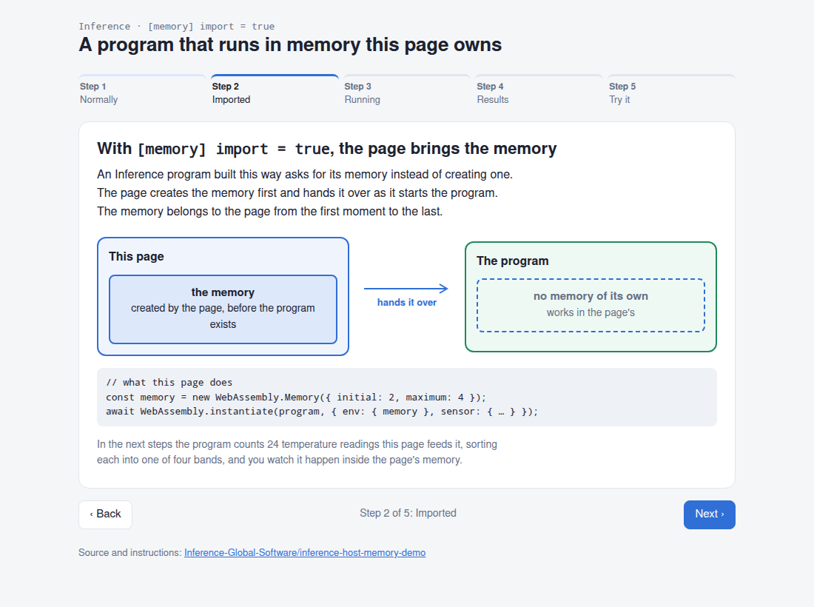
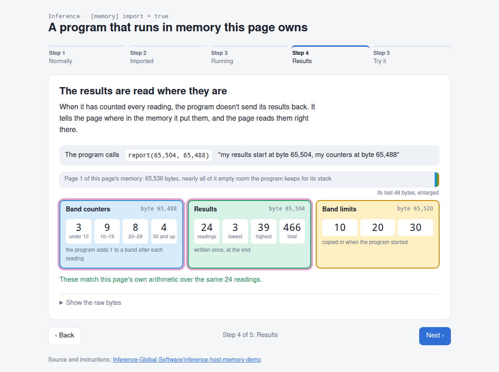

# Inference: a module running in a memory the host owns

A small showcase of `[memory] import = true`. The Inference program in
`src/main.inf` does not define its linear memory: it imports it as
`env.memory`, so the host creates the memory before the module exists, hands
it in at instantiation, and can watch everything the module keeps there.



## What it shows

1. **The host creates the memory.** `new WebAssembly.Memory({ initial: 2, maximum: 4 })`
   exists before the module does. Instantiation writes the module's constant
   table (`BANDS = [10, 20, 30]`) into it, at the top of the first page.
2. **The module computes in it.** `main` carves its stack frame out of the
   host's memory and keeps a histogram array there. The host feeds 24 readings
   through `sample(i)` and can see the histogram's bytes change in its own
   buffer after every call.
3. **Results are read in place.** `report(stats, histogram)` hands the host two
   addresses inside its memory. The host reads both arrays directly, with no
   copy and no lookup of the module's exports, and checks them against its own
   arithmetic.
4. **The program stays in its first page.** It is built with `pages = 1` and
   `max-pages = 4`, so it imports `(memory 1 4)`: at least one page, allowed to
   grow to at most four. Everything it uses lies in page 1. Before the run the
   host writes a marker at the start of page 2, and afterwards every byte above
   page 1 is exactly as the host left it.
5. **You choose the memory.** In the browser, pick how many pages to hand over
   and how far the memory may grow, or one of the quick picks. A memory the
   import admits replays the whole run in that memory. Any other is refused by
   the browser before the program starts, and the page says why in plain words:
   no limit, a limit past four pages, no pages at all, or a memory that starts
   above its own limit.

## The walkthrough

The browser page is a six-step walkthrough, one idea per screen:

1. **Normally**: a program creates its own memory, and the page can only look inside afterwards.
2. **Imported**: with `[memory] import = true`, the page creates the memory and hands it over.
3. **Running**: the program counts readings, and its counters change inside the page's memory.
4. **Results**: the program says where its results are, and the page reads them there.
5. **Growing**: while the program runs, the page grows the memory from 1 page to 4, writing
   its own data into each new page; the program keeps counting in page 1. Then the page asks
   for a fifth page, and the browser refuses: 4 is the maximum the program declared.
6. **Try it**: hand the program a different memory and see it accepted or refused, and why.

The raw bytes behind each number are one click away ("Show the raw bytes").



## Run it

Needs an `infs` and `infc` with compiler ABI 1.11 or newer (the release that
ships `[memory] import`), and Node.js 18 or newer.

```bash
infs build                  # writes out/main.wasm
node host/run.mjs           # terminal animation of the run
node scripts/bundle.mjs     # writes dist/sensor-demo.html
```

`node host/run.mjs --pages 3 --limit 4` runs in a different memory (`--limit
none` asks for one with no limit, which the program refuses).

Open `dist/sensor-demo.html` in a browser: it is self-contained and needs no
server. To work on the page itself, serve the project root
(`python3 -m http.server`) and open `/web/`, which loads `out/main.wasm`
directly.

`node host/run.mjs --plain` prints the same run as a plain log and exits 1 if
the program's report disagrees with the host's arithmetic, if anything above
page 1 changed, or if a memory the import does not admit was accepted, so it
doubles as a test. In the browser, `#normal`, `#imported`, `#running`,
`#results`, `#growing` and `#try` open that step; `#running-12` and
`#growing-12` open that replay paused at frame 12, and `#try-3-4` (or
`#try-1-none`) starts the program in that memory.

## What the build says

```text
memory: 1 page(s) growable to 4, 65536-byte stack, imported from env.memory
host-imports allowlist: sensor.report, sensor.sample, sensor.sample_count
```

The module's first import is `(import "env" "memory" (memory 1 4))`, it has no
memory section of its own, and its `memory` export is the host's object
(`instance.exports.memory === memory`).

The same project refuses the builds that cannot carry an imported memory:
`infs build -v` (no proof artifact for a module that imports its memory) and
`target = "stellar"` (a Soroban contract defines its own memory).

An Inference program never grows its memory itself: nothing the compiler emits
grows memory. A `max-pages` above `pages` is room for the host to grow into,
and the browser stops it at that maximum.

## The embedder contract

The module owns the first `pages` pages of the memory it is given, here page 1:
its shadow stack sits at the bottom and its constants directly above it. A host
may read them, as this one does, but writes into them only through a `mut`
argument during a call to one of its own functions. Everything above them is
the host's, which is where this host keeps its marker. See *Importing the
memory* in the Inference book for the full contract.

## Files

| Path | What it is |
|---|---|
| `src/main.inf` | The Inference program |
| `Inference.toml` | `[memory] import = true` and the host-import allowlist |
| `host/demo-core.mjs` | Creates the memory, runs the module, records every host call |
| `host/run.mjs` | Terminal host and animation |
| `web/index.html`, `web/app.mjs` | Browser view of the same run |
| `scripts/bundle.mjs` | Inlines the page into `dist/sensor-demo.html` |

The build line reports the requested 65536-byte stack, while the module's
actual stack is 65520 bytes, because its 12 bytes of constants sit at the top
of its page. That is a known `infs` reporting issue (Inferara/inference#549).

## License

Apache-2.0; see [LICENSE](LICENSE).
